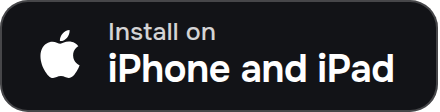

<p align="center">
  <a href="https://olcos.github.io/en/"></a>
</p>

<h1 align="center">olcOS</h1>

<p align="center">
  <b>Bypass internet whitelists through video calls.</b><br>
  A free, open-source app for Android, iPhone and iPad.
</p>

<p align="center">
  <a href="https://github.com/olcOS/olcos/releases/download/v3.0.3-beta/olcOS-3.0.3-beta-android.apk"></a>&nbsp;
  <a href="#iphone-and-ipad"></a>
</p>

<p align="center">
  <a href="https://olcos.github.io/en/">Website</a> ·
  <a href="#how-whitelists-work">How it works</a> ·
  <a href="#troubleshooting">Troubleshooting</a> ·
  <a href="#questions">Questions</a> ·
  <a href="README.md">Русский</a>
</p>

<p align="center">
  
</p>

> [!IMPORTANT]
> Download the app in advance: under whitelists GitHub and the olcOS website don't open. Set up your own server over
> normal internet, for example your home Wi-Fi. During installation the phone connects to the server directly, and
> under whitelists that connection doesn't get through.

## What it is

olcOS helps when mobile internet only works through a whitelist and ordinary VPNs no longer connect. The app carries
your phone's traffic inside an ordinary video call. The phone and your server join the same room on a call service
your carrier lets through, and to the carrier it is just a call. The server receives the traffic and sends it on to
the open internet.

If there are no whitelists and VPNs are simply blocked, olcOS can also connect directly through Xray (VLESS +
REALITY). That is faster than a call.

There are no shared servers, accounts or subscriptions. The app is free and the code is open under the MIT license.

## How whitelists work

Usually individual websites are blocked and the rest of the internet stays open. A whitelist works the other way
round: everything is closed except what is allowed. The carrier only lets a connection through if its address or
domain is on the list, which includes the Gosuslugi state-services portal, VK, Yandex services, marketplaces and
carrier sites ([bne IntelliNews](https://www.intellinews.com/russia-s-mobile-internet-whitelist-mode-has-quietly-become-permanent-459197/)).

- Whitelists are applied to mobile internet. Home broadband and Wi-Fi usually keep working as before.
- Each carrier and region has its own list, and the lists change regularly.
- This is no longer an exception. In July 2026 only about 30% of mobile sessions in Russia's Central Federal
  District were unrestricted, and in border regions nearly 90% of connections went through whitelists
  ([Meduza, citing Kommersant](https://meduza.io/en/news/2026/08/05/kommersant-only-one-third-of-mobile-internet-traffic-in-central-russia-was-unrestricted-nearly-90-in-border-regions-went-through-whitelists)).

Why an ordinary VPN doesn't help, and what olcOS does differently:

| | Where the phone connects | Is it on the whitelist? | Result |
|---|---|---|---|
| Ordinary VPN | to the VPN server | no | the connection is cut at once; obfuscation doesn't help |
| olcOS | to a call service on the whitelist | yes | traffic reaches your server and goes out to the internet |

The one condition: your carrier has to let the chosen call service through. So set up several services on your
server and check in the app which one answers. If mobile internet is shut down completely and even Gosuslugi doesn't
open, no app can help.

## Installation

### Android

Android 8.0 or later on a 64-bit phone (almost all of them are). The file is about 150 MB.

1. Download the file:
   [olcOS-3.0.3-beta-android.apk](https://github.com/olcOS/olcos/releases/download/v3.0.3-beta/olcOS-3.0.3-beta-android.apk).
2. Open the downloaded file. If the phone asks, allow installs from this source.
3. Start olcOS. The first time you connect, Android asks once for VPN permission; accept it.

Your browser and Play Protect may warn that the file isn't from Google Play. That happens with any app from outside
the store: tap "Download anyway", and during installation "More details" → "Install anyway".

A new version installs over the old one and keeps your settings. To have the phone find updates by itself, add olcOS
to [Obtainium](https://apps.obtainium.imranr.dev/redirect?r=obtainium://app/%7B%22id%22%3A%22io.olcos.app%22%2C%22url%22%3A%22https%3A%2F%2Fgithub.com%2FolcOS%2Folcos%22%2C%22author%22%3A%22olcOS%22%2C%22name%22%3A%22olcOS%22%7D).

### iPhone and iPad

iOS 17 or later. olcOS isn't in the App Store, so it is installed from a Windows or macOS computer. You need a cable
and an Apple ID. It's free and takes about 15 minutes. If you're reading this on your phone, open the page on a
computer.

1. On the computer, download
   [olcOS-3.0.3-beta-ios.ipa](https://github.com/olcOS/olcos/releases/download/v3.0.3-beta/olcOS-3.0.3-beta-ios.ipa)
   (about 55 MB) and [Sideloadly](https://sideloadly.io). On Windows you also need iTunes and iCloud from Apple's
   website; the Microsoft Store versions won't work.
2. Connect the iPhone with the cable. If the phone asks whether to trust this computer, tap "Trust".
3. Drag the IPA file into the Sideloadly window, enter your Apple ID and click Start. If Apple sends a verification
   code, enter it.
4. On the iPhone, turn on Developer Mode: Settings → Privacy & Security → Developer Mode. The phone restarts and asks
   you to confirm.
5. Allow the app: Settings → General → VPN & Device Management → your Apple ID → "Trust".
6. Open olcOS.

What a free Apple ID means:

- **Proxy, not VPN.** iOS doesn't allow VPN mode with this kind of signature, so olcOS works as a proxy. Telegram and
  apps that let you set a proxy can use it. After you tap Connect, a proxy card appears on the home screen with a
  "Use in Telegram" button and the `127.0.0.1` address and port for other apps. If you use Potatso or Shadowrocket,
  add the olcOS server to their exclusions; the link is on the same card.
- **Silence plays in the background.** Otherwise iOS unloads the app and the proxy goes away. It doesn't get in the
  way of music or calls.
- **The signature lasts 7 days.** After that the app stops opening. Install it again the same way, with Sideloadly and
  the same Apple ID, and your data stays.
- **Three apps at most.** You can keep no more than three apps installed this way at the same time.
- **An error about App IDs or extensions.** In Sideloadly, open Advanced Options and turn on removing extensions
  (Remove app extensions). With a free Apple ID the VPN tunnel and widgets don't work anyway.

With a paid Apple Developer account you get a full-device VPN, widgets and Live Activity, and the signature lasts a
year. In that case don't remove the extensions: the VPN lives in them.

AltStore or SideStore work instead of Sideloadly too; they renew the signature weekly while running. If AltStore asks
what to do with the extensions and you use a free Apple ID, remove them.

## Server

olcOS sends your traffic through your own server (a VPS); it is your exit to the internet. The phone doesn't connect
to it directly, they meet in a call. That is why the server can be anywhere, for example abroad.

You don't have to run your own server. If a friend or relative already has one, ask them for an invite (see
[First connection](#first-connection)).

What the server needs:

- Linux and a root login. Ubuntu or Debian is best; Fedora, CentOS and Arch work too.
- 1 GB of memory and 10 GB of disk or more. The core is built on the server itself. With less than 2 GB of memory and
  no swap, the installer adds a 2 GB swap file by itself.
- The cheapest plan from any host is enough.

Set the server up over normal internet or Wi-Fi: during installation the phone connects to it directly.

### From the app

1. In olcOS tap "+" → "My own server (VPS)". On Android the "+" button is on the Connections tab.
2. Enter the server address and the root password from your host's email. An SSH key works instead of a password.
3. Pick the call services, preferably several: there is no telling in advance which one your carrier lets through.
   On Android you pick one during installation and add the rest later on the server's page. For Jitsi the app finds
   a server that lets your VPS in by itself.
4. Keep olcOS open while it installs; it takes a few minutes. Your phone becomes the server's owner.

### With one command

If you prefer a terminal, run this on the server as root:

```bash
curl -fsSL https://raw.githubusercontent.com/olcOS/olcos/main/install.sh | sudo bash
```

The script finds a Jitsi server that lets your VPS in, creates a room, installs the management agent and shows a QR
code. Scan it in olcOS and your phone becomes the server's owner. Add other call services later in the app, on the
server's page. If you run the script again, the server stays as it is and you get a new QR code.

<details>
<summary>Settings for advanced users</summary>

The installer uses the values that worked best in testing, and you can change them with environment variables:

```bash
curl -fsSL https://raw.githubusercontent.com/olcOS/olcos/main/install.sh | sudo env OLCOS_NAME=home bash
```

| Variable | What it sets | Default |
|---|---|---|
| `OLCOS_CARRIER` | the call service | `jitsi` |
| `OLCOS_ROOM` | the room (a call link) | made automatically for Jitsi |
| `OLCOS_JITSI_URL` | the Jitsi server | the first one on the list that lets your VPS in |
| `OLCOS_TRANSPORT` | how data travels inside the call | `vp8channel`, or `datachannel` where the service doesn't carry it |
| `OLCOS_VP8_FPS` | frames per second for `vp8channel` | `30` (1–120) |
| `OLCOS_VP8_BATCH` | packets per frame for `vp8channel` | `64` (1–256) |
| `OLCOS_NAME` | the server's name in the app | the hostname |

All variables are described at the top of
[server/install.sh](https://github.com/olcOS/olcos-core/blob/main/server/install.sh). On the phone, frames and packets
are changed in the app's settings. An Xray server is installed by a separate script,
[server/xray/install.sh](https://github.com/olcOS/olcos-core/blob/main/server/xray/install.sh): the port, the
camouflage site and the version are set with `OLCOS_XRAY_*` variables.

</details>

## First connection

1. Tap Connect on the home screen.
2. Open "Connection check". It shows which call service answers and how fast.
3. To give access to family, open your server → "Share" → "Invite a device". Each device gets its own link. Invites
   work between iPhone and Android.

You can also add a connection another way: "+" → a link, QR code, file or subscription. On iPhone there are
"Ready-made lists" of free servers, but other people run them: speed isn't guaranteed, and the owners of those
servers see your traffic.

Connection links and invites contain keys. Don't publish them.

## Call services

olcOS works through WebRTC video-call services. The list is in the app and grows with updates.

- The only way to know which service your carrier lets through is to test it: each carrier and region has its own
  list, and it changes. Keep several services on your server and see in "Connection check" which one answers.
- Some services need you to sign in, so the app can create and renew rooms by itself. The app doesn't keep your
  password, only the sign-in session on this phone. You can sign out in settings.
- The others need no account.

## Plain Xray

If there are no whitelists but VPNs are blocked, connect directly through Xray (VLESS + REALITY). It is faster than a
call, but doesn't work under whitelists: the phone connects straight to the server.

- You can add your own `vless://` link with REALITY, or a subscription with such links: "+" → a link, QR code or
  subscription.
- On iPhone you can install Xray on your server right from the app, together with the calls. Leave the port and the
  camouflage site as they are or set your own.
- Android doesn't install Xray on a server yet, but connects with a ready link.

## Modes

| | VPN | Proxy (SOCKS5) |
|---|---|---|
| What goes through olcOS | the whole phone | apps where the proxy is set, such as Telegram |
| Android | yes | yes |
| iPhone, free Apple ID | no | yes |
| iPhone, paid developer account | yes | yes |

By default everything goes through the tunnel. In settings you can send Russian websites directly, around the
tunnel.

## Troubleshooting

| What happens | What to do |
|---|---|
| Nothing opens with olcOS, but Gosuslugi opens without it | Your carrier doesn't let the chosen call service through. Open "Connection check" and connect to the one that answers. Add rooms on other call services to your server. |
| Nothing opens at all, not even Gosuslugi | Mobile internet has been shut down completely. No app can help here. |
| It won't connect | "Connection check" shows which protocol answers. For a subscription, tap "Find the fastest and connect". |
| It's slow | Measure the protocols in "Connection check" and connect to the fastest one, or to "Whole server" if combining rooms adds speed. |
| The iPhone runs a proxy instead of a VPN | The app is signed with a free Apple ID and iOS didn't allow VPN. To get VPN, sign the app with a paid developer account and choose VPN in settings. |
| The iPhone says "Untrusted Developer" | Settings → General → VPN & Device Management → your Apple ID → "Trust". |
| The app on the iPhone stopped opening | Seven days have passed and the signature expired. Install the app again with Sideloadly and the same Apple ID. |
| Android won't install the file | Allow installs for your browser or Files app: look for "Install unknown apps" in the phone's settings. |
| You need help | Collect the log: on iPhone Settings → "View all logs" → "Export all logs", on Android Settings → "Diagnostics" → "Copy the log". Make sure no keys, passwords, full links or server addresses are left in it and [open an issue](https://github.com/olcOS/olcos/issues/new/choose). |

## Limitations

- The VPN carries only TCP over IPv4; DNS goes through the tunnel too. Games and messenger calls that need UDP, and
  IPv6-only sites, may not work. Websites, messaging, email and most apps work.
- Speed depends on the call service and your network. A service can close a room or limit guests, so keep several
  services on your server.
- This is a beta; behaviour and compatibility are still changing.

## Questions

**How can I tell that whitelists are on?**
Turn off your VPN and open a site that normally works without one, such as google.com. If it doesn't open but
Gosuslugi and Yandex do, whitelists are on.

**How much does it cost?**
The app is free. You only pay your host for the server, if you run your own.

**Is olcOS on Google Play or the App Store?**
No. On Android you install it from the APK file; on iPhone you install it from a computer as described above.

**Is the app available in English?**
Yes. The iPhone app is in English, Russian and French, the Android app in English and Russian.

**Why does iPhone need a computer?**
That is the only way iPhone installs apps from outside the App Store. With a free Apple ID you get a proxy and must
renew the signature every 7 days. With a paid developer account you get a VPN and the signature lasts a year.

**Who can see my traffic?**
The call service sees that you are in a call. Your server sees where the traffic goes next, so it should belong to
you or someone you trust. The project runs no servers of its own and collects no user data.

**Am I allowed to use it?**
Use olcOS within the laws of your country and the terms of the services your traffic passes through.

## How it is built

The phone and the server join the same video room as two call participants and exchange data over WebRTC: inside
the video stream (`vp8channel`) or over the call's data channel (`datachannel`), whichever the service carries. There
can be several rooms on different services. olcOS combines them into one channel: the load is split between rooms,
and if one drops, the connection keeps working through the others.

Speed depends on the call service, the network and the video channel settings. In our test on 6 November 2026 (a
server in the Netherlands, Jitsi, 30 frames of 64 packets) the tunnel gave about 9 Mbit/s each way. Per-service
measurements are in the olcrtc core's documentation
([gate.ru.md](https://github.com/ghostlane-project/olcrtc/blob/0955ba7f2041d1480524292c4af4135a192fe267/docs/gate.ru.md)).
Your numbers will differ.

## For developers

- [olcos-core](https://github.com/olcOS/olcos-core): the shared Go core (olcrtc and Xray), the server scripts and the
  installer.
- [olcos-ios](https://github.com/olcOS/olcos-ios): the iPhone and iPad app (SwiftUI).
- [olcos-android](https://github.com/olcOS/olcos-android): the Android app (Kotlin, Jetpack Compose).
- [olcos.github.io](https://github.com/olcOS/olcos.github.io): the website.
- This repository: releases, the short server installer and the user guide.

## Bugs and security

Open an [issue](https://github.com/olcOS/olcos/issues) and include your phone, system version and olcOS version.
Don't post connection links, keys or your server addresses. Report vulnerabilities privately as described in
[SECURITY.md](https://github.com/olcOS/olcos-ios/blob/main/SECURITY.md).

## License

olcOS code is released under the [MIT](LICENSE) license. The tunnel is built on
[olcrtc](https://github.com/ghostlane-project/olcrtc) (Apache-2.0); the direct mode uses
[Xray-core](https://github.com/XTLS/Xray-core) (MPL-2.0).
