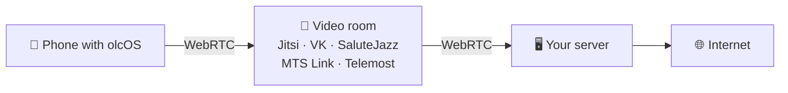

<div align="center">
  <a href="https://olcos.github.io/en/"></a>
  <h1>olcOS</h1>
  <p><b>Your phone. Your server. Your connection.</b></p>
  <p>A VPN and SOCKS5 proxy through a server of your own, hidden inside an ordinary video call.</p>
  <p>
    
    
    <a href="https://github.com/olcOS/olcos/releases/latest"></a>
    
  </p>
  <p>
    <a href="https://github.com/olcOS/olcos/releases/latest"></a>
    &nbsp;
    <a href="https://github.com/olcOS/olcos/releases/latest"></a>
  </p>
  <p><a href="https://olcos.github.io/en/">Website</a> · <a href="https://github.com/olcOS/olcos-ios">iOS</a> · <a href="https://github.com/olcOS/olcos-android">Android</a> · <a href="README.md">Русский</a></p>
</div>

<p align="center">
  
  &nbsp;
  
  &nbsp;
  
</p>

## How it works



The call service sees an ordinary call; you get a VPN for the whole phone or a SOCKS5 proxy for single apps. When no
call is needed, a direct VLESS + REALITY mode is there too.

## Features

| | |
|---|---|
| 🔗 **The whole server at once** | Several rooms bond into one channel. A large download uses all of them; one dropping does not cut the connection. |
| 🔁 **It does not give up** | A dead connection is noticed quickly and rejoined until you stop it. Only errors a retry cannot cure stop it. |
| 📲 **Manage it from the phone** | Rooms, keys, the core update and invites for family — right in the app. |
| 🛡 **VPN or proxy** | A VPN for the whole phone, or SOCKS5 for one app such as Telegram. |
| 🔒 **Yours only** | No shared servers or accounts: traffic goes through a server that belongs to you. |

## Install the server

```bash
curl -fsSL https://raw.githubusercontent.com/olcOS/olcos/main/install.sh | sudo bash
```

Debian, Ubuntu, Fedora or CentOS with root access. At the end the script shows a QR code: scan it with olcOS and the
phone becomes the server's owner.

## Platforms

| | Requirements | Source |
|---|---|---|
| **iPhone and iPad** | iOS 17+, installed with Sideloadly, AltStore or SideStore | [olcos-ios](https://github.com/olcOS/olcos-ios) |
| **Android** | Android 8.0+, an `.apk` file | [olcos-android](https://github.com/olcOS/olcos-android) |
| **Server** | Linux with root access, 1 GB of memory | [install.sh](install.sh) |

<details>
<summary><b>Install the app</b></summary>

**iPhone and iPad.** Download the `.ipa` from the [latest release](https://github.com/olcOS/olcos/releases/latest) and install
it with Sideloadly, AltStore or SideStore. With a free Apple ID iOS does not let apps run a VPN, so the SOCKS5 mode works;
the whole-phone VPN needs a paid developer account.

**Android.** Download the `.apk`, allow installs from this source and open the file. For VPN the system asks once.
</details>

<details>
<summary><b>Speed and honest limits</b></summary>

Speed depends on the video room, not on your server. On the core's test bench: MTS Link about 15 Mbit/s, Jitsi about 5,
SaluteJazz 2–3. VK Calls has not been measured yet. Yours will differ.

- A call service can close a room, set a limit or turn guests away. That is why olcOS keeps several protocols and can
  change rooms.
- The VPN carries TCP over IPv4. Apps that need UDP or IPv6 may not work through it.
- This is a beta: the interface and compatibility change.
- Use olcOS within the law and the rules of the services your traffic travels through.
</details>

<details>
<summary><b>What it is made of</b></summary>

Clients: SwiftUI (iOS) and Kotlin with Jetpack Compose (Android). A shared Go core: a tunnel over WebRTC built on
[olcrtc](https://github.com/ghostlane-project/olcrtc), and the bonding of rooms into one channel. MIT license.
</details>
