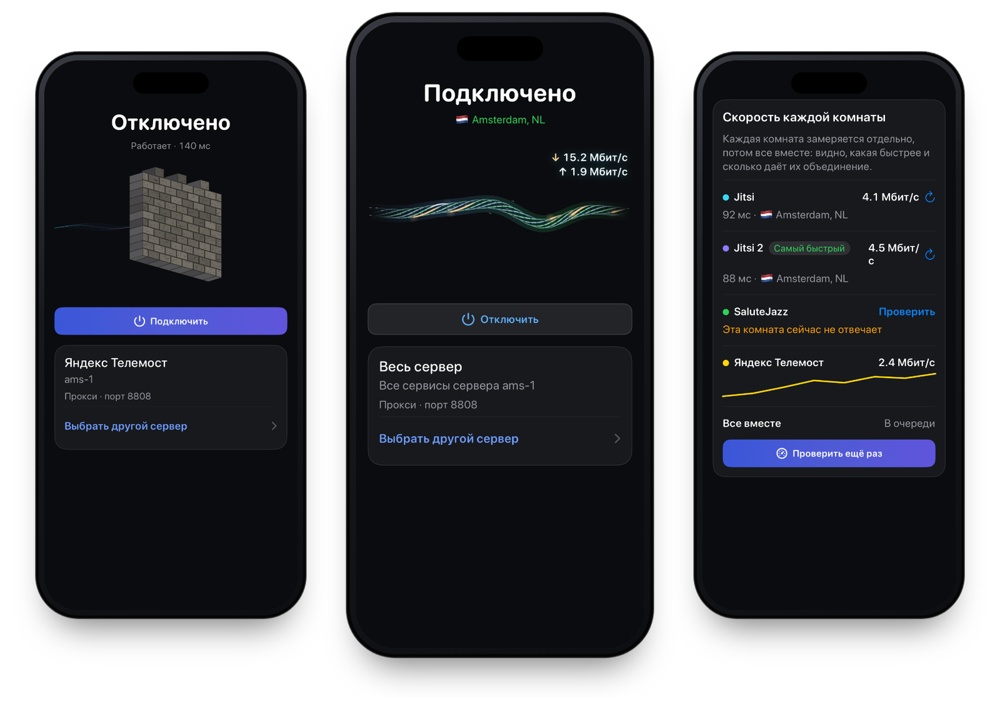

<p align="center">
  <a href="https://olcos.github.io/en/"></a>
</p>

<h1 align="center">olcOS</h1>

<p align="center">
  A self-hosted VPN that runs over video calls. Apps for iPhone, iPad and Android, plus a server installer.
</p>

<p align="center">
  <a href="https://github.com/olcOS/olcos/releases/latest"></a>
  
  
  <a href="LICENSE"></a>
</p>

<p align="center">
  <a href="https://olcos.github.io/en/">Website</a> ·
  <a href="https://github.com/olcOS/olcos/releases/latest">Download</a> ·
  <a href="https://github.com/olcOS/olcos-ios">iOS</a> ·
  <a href="https://github.com/olcOS/olcos-android">Android</a> ·
  <a href="README.md">Русский</a>
</p>

<p align="center">
  
</p>

olcOS sends your phone's traffic through a server you own. Between the phone and the server the data travels inside
an ordinary video call on Yandex Telemost, VK Calls, SaluteJazz, Jitsi or MTS Link. When a call isn't needed, the
phone can also connect to the server directly over VLESS + REALITY.

There are no shared servers and no accounts. You run the server and manage it from your phone.

## Download

Get the files from the [latest release](https://github.com/olcOS/olcos/releases/latest); SHA-256 checksums are listed
in the release notes.

| Platform | File | Requirements |
|---|---|---|
| iPhone and iPad | `.ipa` | iOS 17 or later, installed with Sideloadly, AltStore or SideStore |
| Android | `.apk` | Android 8.0 or later |

With a free Apple ID, iOS does not let sideloaded apps turn on a VPN, so on iPhone olcOS works as a SOCKS5 proxy, for
example for Telegram. A device-wide VPN works when the app is signed with a paid Apple Developer account. Android has
no such limit: the system asks for VPN permission once, on the first connection. Android users can get updates
automatically with [Obtainium](https://apps.obtainium.imranr.dev/redirect?r=obtainium://app/%7B%22id%22%3A%22io.olcos.app%22%2C%22url%22%3A%22https%3A%2F%2Fgithub.com%2FolcOS%2Folcos%22%2C%22author%22%3A%22olcOS%22%2C%22name%22%3A%22olcOS%22%7D).

The iOS app is available in English, Russian and French; the Android app in English and Russian.

## Server

You need a Linux VPS (Debian, Ubuntu, Fedora or CentOS) with root access. Install the server from the app over SSH,
or run one command on the server itself:

```bash
curl -fsSL https://raw.githubusercontent.com/olcOS/olcos/main/install.sh | sudo bash
```

The script sets up a Jitsi room and the management agent, then prints a QR code. Scan it in olcOS and that phone
becomes the server's owner. More rooms, protocols, updates and invites for other devices are all handled in the app.

## How it works

The phone and the server join the same video room as two call participants and exchange data over WebRTC. You can
keep several rooms on different services at once. olcOS bonds them into one channel: traffic is shared between the
rooms, and if one drops, the connection keeps going over the rest.

Speed depends mostly on the call service. In the olcrtc core's release measurements VK Calls reached 13–19 Mbit/s,
MTS Link about 15 Mbit/s and SaluteJazz about 3 Mbit/s
([settings.md](https://github.com/ghostlane-project/olcrtc/blob/0955ba7f2041d1480524292c4af4135a192fe267/docs/settings.md),
[gate.md](https://github.com/ghostlane-project/olcrtc/blob/0955ba7f2041d1480524292c4af4135a192fe267/docs/gate.md)).
Your numbers will differ.

Worth knowing up front:

- the VPN carries TCP over IPv4, so apps that need UDP or IPv6 may not work through it;
- a call service can close a room or restrict guests, so it helps to keep more than one protocol;
- this is a beta, and behaviour and compatibility still change.

## Repositories

- [olcos-ios](https://github.com/olcOS/olcos-ios): the iPhone and iPad app (SwiftUI) and the shared Go core.
- [olcos-android](https://github.com/olcOS/olcos-android): the Android app (Kotlin, Jetpack Compose).
- [olcos.github.io](https://github.com/olcOS/olcos.github.io): the website.
- This repository: releases and the server installer.

## Bugs and questions

Open an [issue](https://github.com/olcOS/olcos/issues). Please don't post connection links, keys or your server
addresses. Report vulnerabilities privately, as described in
[SECURITY.md](https://github.com/olcOS/olcos-ios/blob/main/SECURITY.md).

Use olcOS within the law of your country and the terms of the services your traffic goes through.

## License

olcOS is released under the [MIT](LICENSE) license. The tunnel is built on
[olcrtc](https://github.com/ghostlane-project/olcrtc) (Apache-2.0); the direct mode uses
[Xray-core](https://github.com/XTLS/Xray-core) (MPL-2.0).
