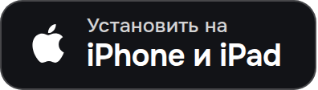
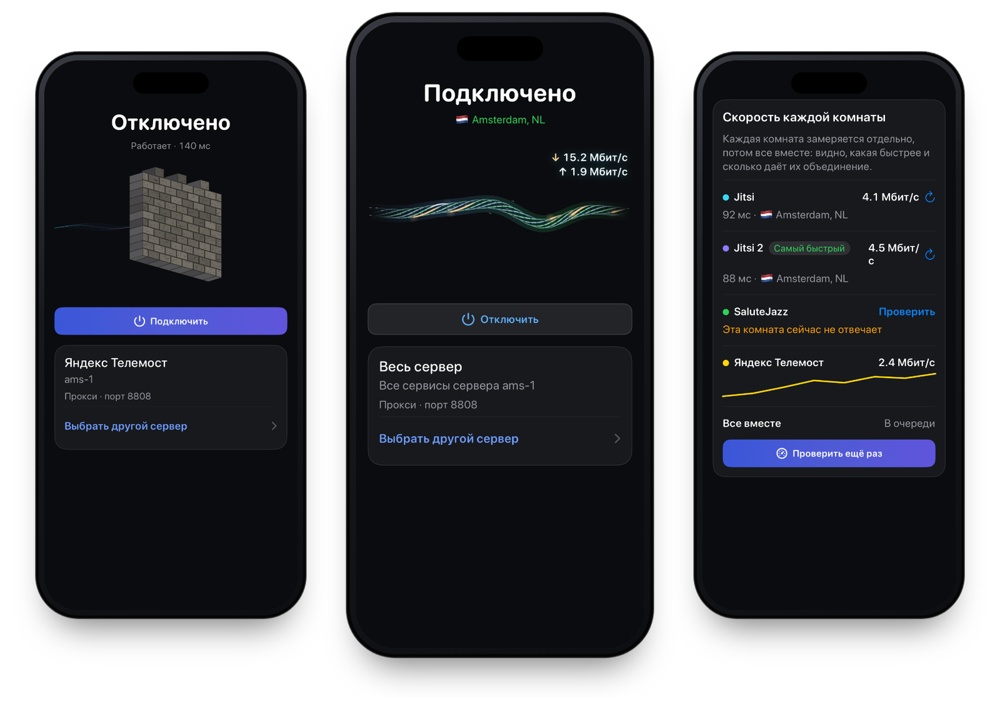

<p align="center">
  <a href="https://olcos.github.io"></a>
</p>

<h1 align="center">olcOS</h1>

<p align="center">
  <b>Обход белых списков через видеозвонки.</b><br>
  Бесплатное приложение для Android, iPhone и iPad с открытым кодом.
</p>

<p align="center">
  <a href="https://github.com/olcOS/olcos/releases/download/v3.0.3-beta/olcOS-3.0.3-beta-android.apk"></a>&nbsp;
  <a href="#iphone-и-ipad"></a>
</p>

<p align="center">
  <a href="https://olcos.github.io">Сайт</a> ·
  <a href="#как-работают-белые-списки">Как это работает</a> ·
  <a href="#если-не-работает">Если не работает</a> ·
  <a href="#вопросы">Вопросы</a> ·
  <a href="README.en.md">English</a>
</p>

<p align="center">
  
</p>

> [!IMPORTANT]
> Скачайте приложение заранее: при белых списках GitHub и сайт olcOS не открываются. Свой сервер ставьте через
> обычный интернет, например через домашний Wi‑Fi. При установке телефон подключается к серверу напрямую, а при
> белых списках такое подключение не проходит.

## Что это

olcOS помогает, когда мобильный интернет работает по белому списку и обычный VPN перестал подключаться. Приложение
ведёт трафик телефона внутри обычного видеозвонка. Телефон и ваш сервер заходят в одну комнату сервиса звонков,
который пропускает оператор, и для оператора это просто звонок. Сервер принимает трафик и выпускает его в обычный
интернет.

Если белых списков нет, а VPN просто блокируют, olcOS умеет подключаться и напрямую, через Xray (VLESS + REALITY).
Так быстрее, чем через звонок.

Общих серверов, аккаунтов и подписок нет. Приложение бесплатное, код открыт под лицензией MIT.

## Как работают белые списки

Обычно блокируют отдельные сайты, а остальной интернет открыт. Белый список устроен наоборот: закрыто всё, кроме
разрешённого. Оператор пропускает соединение, только если адрес или домен есть в перечне. В него входят Госуслуги,
банки, маркетплейсы, сервисы VK и Яндекса
([Википедия](https://ru.wikipedia.org/wiki/%C2%AB%D0%91%D0%B5%D0%BB%D1%8B%D0%B5_%D1%81%D0%BF%D0%B8%D1%81%D0%BA%D0%B8%C2%BB_%D1%81%D0%B0%D0%B9%D1%82%D0%BE%D0%B2_%D0%B2_%D0%A0%D0%BE%D1%81%D1%81%D0%B8%D0%B8)).

- Белые списки включают на мобильном интернете. Домашний интернет и Wi-Fi обычно работают как раньше.
- У каждого оператора и региона свой перечень, и он регулярно меняется.
- Это уже не редкость. В июле 2026 года в Центральном федеральном округе без ограничений проходило около 30%
  мобильных подключений, а в приграничных регионах почти 90% шло через белые списки
  ([Meduza по данным «Коммерсанта»](https://meduza.io/en/news/2026/08/05/kommersant-only-one-third-of-mobile-internet-traffic-in-central-russia-was-unrestricted-nearly-90-in-border-regions-went-through-whitelists)).

Почему обычный VPN не помогает и чем отличается olcOS:

| | Куда подключается телефон | Это есть в белом списке? | Что получается |
|---|---|---|---|
| Обычный VPN | к VPN-серверу | нет | соединение обрывается сразу, маскировка не спасает |
| olcOS | к сервису звонков из белого списка | да | трафик доходит до вашего сервера и уходит в интернет |

Главное условие: ваш оператор должен пропускать выбранный сервис звонков. Поэтому настройте на сервере несколько
сервисов, а в приложении проверьте, какой из них отвечает. Если мобильный интернет отключили полностью и не
открываются даже Госуслуги, не поможет ни одно приложение.

## Установка

### Android

Android 8.0 или новее, 64-битный телефон (таких почти все). Файл весит около 150 МБ.

1. Скачайте файл:
   [olcOS-3.0.3-beta-android.apk](https://github.com/olcOS/olcos/releases/download/v3.0.3-beta/olcOS-3.0.3-beta-android.apk).
2. Откройте скачанный файл. Если телефон спросит, разрешите установку из этого источника.
3. Запустите olcOS. При первом подключении Android один раз попросит разрешение на VPN, согласитесь.

Браузер и Play Защита могут предупредить, что файл не из Google Play. Так бывает с любым приложением не из
магазина: нажмите «Всё равно скачать», а при установке «Подробнее» → «Всё равно установить».

Новая версия ставится поверх старой, настройки сохраняются. Чтобы телефон сам находил обновления, добавьте olcOS в
[Obtainium](https://apps.obtainium.imranr.dev/redirect?r=obtainium://app/%7B%22id%22%3A%22io.olcos.app%22%2C%22url%22%3A%22https%3A%2F%2Fgithub.com%2FolcOS%2Folcos%22%2C%22author%22%3A%22olcOS%22%2C%22name%22%3A%22olcOS%22%7D).

### iPhone и iPad

iOS 17 или новее. olcOS нет в App Store, поэтому приложение ставится с компьютера на Windows или macOS. Понадобятся
кабель и Apple ID. Это бесплатно и займёт около 15 минут. Если вы читаете это на телефоне, откройте страницу на
компьютере.

1. На компьютере скачайте файл
   [olcOS-3.0.3-beta-ios.ipa](https://github.com/olcOS/olcos/releases/download/v3.0.3-beta/olcOS-3.0.3-beta-ios.ipa)
   (около 55 МБ) и программу [Sideloadly](https://sideloadly.io). На Windows ещё нужны iTunes и iCloud с сайта
   Apple, версии из Microsoft Store не подойдут.
2. Подключите iPhone кабелем. Если телефон спросит, доверять ли этому компьютеру, нажмите «Доверять».
3. Перетащите файл IPA в окно Sideloadly, введите свой Apple ID и нажмите Start. Если Apple пришлёт код
   подтверждения, введите его.
4. На iPhone включите режим разработчика: Настройки → Конфиденциальность и безопасность → Режим разработчика.
   Телефон перезагрузится и попросит подтвердить включение.
5. Разрешите приложение: Настройки → Основные → VPN и управление устройством → ваш Apple ID → «Доверять».
6. Откройте olcOS.

Что нужно знать про бесплатный Apple ID:

- **Работает прокси, а не VPN.** С такой подписью iOS не разрешает режим VPN, поэтому olcOS работает как прокси.
  Его понимают Telegram и приложения, в которых можно указать прокси. После «Подключить» на главном экране появится
  карточка с кнопкой «В Telegram», там же адрес `127.0.0.1` и порт для других приложений. Если пользуетесь
  Potatso или Shadowrocket, добавьте сервер olcOS в их исключения, ссылка есть на той же карточке.
- **В фоне играет тишина.** Иначе iOS выгрузит приложение, и прокси пропадёт. Музыке и звонкам это не мешает.
- **Подпись действует 7 дней.** Потом приложение перестанет открываться. Поставьте его заново так же, через
  Sideloadly и с тем же Apple ID, и данные сохранятся.
- **Не больше трёх приложений.** Одновременно можно держать не больше трёх приложений, установленных так.
- **Ошибка про App ID или расширения.** Откройте в Sideloadly Advanced Options и включите удаление расширений
  (Remove app extensions). С бесплатным Apple ID туннель VPN и виджеты всё равно не работают.

С платным аккаунтом разработчика Apple работают VPN на весь телефон, виджеты и Live Activity, а подпись действует
год. В этом случае расширения не удаляйте: VPN находится в них.

Вместо Sideloadly можно взять AltStore или SideStore: они сами продлевают подпись раз в неделю, пока запущены. Если
AltStore спросит, что делать с расширениями, при бесплатном Apple ID уберите их.

## Сервер

olcOS ведёт трафик через ваш собственный сервер (VPS), это ваш выход в интернет. Телефон не подключается к нему
напрямую, они встречаются в звонке. Поэтому сервер может стоять где угодно, например за границей.

Свой сервер не обязателен. Если он уже есть у друга или родственника, попросите у него приглашение (см.
[Первое подключение](#первое-подключение)).

Что нужно от сервера:

- Linux и вход под root. Лучше Ubuntu или Debian, подойдут и Fedora, CentOS, Arch.
- 1 ГБ памяти и от 10 ГБ диска. Ядро собирается прямо на сервере. Если памяти меньше 2 ГБ и подкачки нет,
  установщик сам добавит файл подкачки на 2 ГБ.
- Хватит самого недорогого тарифа у любого хостинга.

Ставить сервер нужно через обычный интернет или Wi‑Fi: при установке телефон подключается к нему напрямую.

### Из приложения

1. В olcOS нажмите «+» → «Свой сервер (VPS)». На Android кнопка «+» находится на вкладке «Подключения».
2. Введите адрес сервера и пароль root из письма хостинга. Вместо пароля можно ключ SSH.
3. Выберите сервисы звонков, лучше несколько: заранее не угадать, какой пропустит ваш оператор. На Android при
   установке выбирается один, остальные добавляются потом на странице сервера. Для Jitsi приложение само найдёт
   сервер, который пускает ваш VPS.
4. Не закрывайте olcOS, пока идёт установка, это несколько минут. Телефон станет владельцем сервера.

### Одной командой

Если удобнее терминал, выполните на сервере от root:

```bash
curl -fsSL https://raw.githubusercontent.com/olcOS/olcos/main/install.sh | sudo bash
```

Скрипт сам найдёт сервер Jitsi, который пускает ваш VPS, создаст комнату, поставит агент управления и покажет
QR-код. Отсканируйте его в olcOS, и телефон станет владельцем сервера. Другие сервисы звонков добавьте потом в
приложении на странице сервера. Если запустить скрипт ещё раз, сервер останется как был, а QR-код будет новый.

<details>
<summary>Настройки для опытных</summary>

Установщик берёт значения, которые лучше всего показали себя в проверках, но их можно поменять переменными
окружения:

```bash
curl -fsSL https://raw.githubusercontent.com/olcOS/olcos/main/install.sh | sudo env OLCOS_NAME=home bash
```

| Переменная | Что задаёт | По умолчанию |
|---|---|---|
| `OLCOS_CARRIER` | сервис звонков | `jitsi` |
| `OLCOS_ROOM` | комната (ссылка на звонок) | для Jitsi создаётся сама |
| `OLCOS_JITSI_URL` | сервер Jitsi | первый из списка, который пускает ваш VPS |
| `OLCOS_TRANSPORT` | как данные идут внутри звонка | `vp8channel`, а где сервис его не пропускает, `datachannel` |
| `OLCOS_VP8_FPS` | кадров в секунду для `vp8channel` | `30` (1–120) |
| `OLCOS_VP8_BATCH` | пакетов в кадре для `vp8channel` | `64` (1–256) |
| `OLCOS_NAME` | имя сервера в приложении | имя хоста |

Все переменные описаны в начале
[server/install.sh](https://github.com/olcOS/olcos-core/blob/main/server/install.sh). На телефоне кадры и пакеты
меняются в настройках приложения. Сервер Xray ставит отдельный скрипт
[server/xray/install.sh](https://github.com/olcOS/olcos-core/blob/main/server/xray/install.sh): порт, сайт для
маскировки и версия задаются переменными `OLCOS_XRAY_*`.

</details>

## Первое подключение

1. Нажмите «Подключить» на главном экране.
2. Откройте «Проверку соединения». Она покажет, какой сервис звонков отвечает и с какой скоростью.
3. Чтобы дать доступ близким, откройте свой сервер → «Поделиться» → «Пригласить устройство». Для каждого
   устройства создаётся своя ссылка. Приглашения работают между iPhone и Android.

Подключение можно добавить и по-другому: «+» → ссылка, QR-код, файл или подписка. На iPhone есть «Готовые
подборки» бесплатных серверов, но их ведут другие люди: скорость там не гарантирована, а владельцы этих серверов
видят ваш трафик.

Ссылки подключения и приглашения содержат ключи. Не публикуйте их.

## Сервисы звонков

olcOS работает через сервисы видеозвонков на WebRTC. Их список есть в приложении и пополняется с обновлениями.

- Какой сервис пропускает ваш оператор, можно узнать только проверкой: у каждого оператора и региона свой список,
  и он меняется. Держите на сервере несколько сервисов и смотрите в «Проверке соединения», какой отвечает.
- Для части сервисов нужен вход в аккаунт, чтобы приложение само создавало и продлевало комнаты. Пароль приложение
  не сохраняет, только сессию входа на этом телефоне. Выйти можно в настройках.
- Для остальных аккаунт не нужен.

## Обычный Xray

Если белых списков нет, а VPN блокируют, подключайтесь напрямую через Xray (VLESS + REALITY). Это быстрее звонка,
но при белых списках не работает: телефон подключается прямо к серверу.

- Свою ссылку `vless://` с REALITY или подписку с такими ссылками можно добавить в olcOS: «+» → ссылка, QR-код или
  подписка.
- На iPhone Xray можно поставить на свой сервер прямо из приложения, вместе со звонками. Порт и сайт для маскировки
  можно оставить как есть или указать свои.
- Android пока не ставит Xray на сервер, но подключается по готовой ссылке.

## Режимы

| | VPN | Прокси (SOCKS5) |
|---|---|---|
| Что идёт через olcOS | весь телефон | приложения, где указан прокси, например Telegram |
| Android | есть | есть |
| iPhone, бесплатный Apple ID | нет | есть |
| iPhone, платный аккаунт разработчика | есть | есть |

По умолчанию через туннель идёт всё. В настройках можно пустить российские сайты напрямую, мимо туннеля.

## Если не работает

| Что происходит | Что сделать |
|---|---|
| С olcOS ничего не открывается, а без него Госуслуги работают | Оператор не пропускает выбранный сервис звонков. Откройте «Проверку соединения» и подключитесь к тому, что отвечает. Добавьте на сервер комнаты других сервисов звонков. |
| Не открывается вообще ничего, даже Госуслуги | Мобильный интернет отключили полностью. Тут не поможет ни одно приложение. |
| Не подключается | «Проверка соединения» покажет, какой протокол отвечает. Для подписки нажмите «Найти самый быстрый и подключиться». |
| Медленно | Замерьте протоколы в «Проверке соединения» и подключитесь к самому быстрому или ко «Всему серверу», если склейка комнат даёт прибавку. |
| На iPhone работает прокси вместо VPN | Приложение подписано бесплатным Apple ID, и iOS не разрешила VPN. Чтобы получить VPN, подпишите приложение платным аккаунтом разработчика и выберите VPN в настройках. |
| iPhone пишет «Ненадёжный разработчик» | Настройки → Основные → VPN и управление устройством → ваш Apple ID → «Доверять». |
| Приложение на iPhone перестало открываться | Прошло 7 дней, подпись закончилась. Поставьте приложение заново через Sideloadly с тем же Apple ID. |
| Android не даёт установить файл | Разрешите установку для браузера или «Файлов»: в настройках телефона найдите «Установка неизвестных приложений». |
| Нужна помощь | Соберите журнал: на iPhone Настройки → «Смотреть все логи» → «Выгрузить все логи», на Android Настройки → «Диагностика» → «Скопировать журнал». Проверьте, чтобы в нём не осталось ключей, паролей, полных ссылок и адреса сервера, и [создайте issue](https://github.com/olcOS/olcos/issues/new/choose). |

## Ограничения

- Через VPN идёт только TCP поверх IPv4, DNS тоже идёт через туннель. Игры и звонки в мессенджерах, которым нужен
  UDP, и сайты только с IPv6 могут не работать. Сайты, переписка в мессенджерах, почта и большинство приложений работают.
- Скорость зависит от сервиса звонков и сети. Сервис может закрыть комнату или ограничить гостей, поэтому лучше
  держать на сервере несколько сервисов.
- Это бета, поведение и совместимость ещё меняются.

## Вопросы

**Как понять, что включили именно белые списки?**
Выключите VPN и откройте сайт, который обычно работает и без него, например google.com. Если он не открывается, а
Госуслуги и Яндекс работают, значит, включены белые списки.

**Сколько это стоит?**
Приложение бесплатное. Платить придётся только хостингу за сервер, если вы ставите свой.

**Есть ли olcOS в Google Play или App Store?**
Нет. Android-версия ставится из файла APK, а на iPhone приложение устанавливается с компьютера, как описано выше.

**Почему на iPhone нужен компьютер?**
Приложения не из App Store iPhone ставит только так. С бесплатным Apple ID работает прокси и подпись нужно
обновлять раз в 7 дней. С платным аккаунтом разработчика работает VPN, а подпись действует год.

**Кто видит мой трафик?**
Сервис звонков видит, что вы в звонке. Ваш сервер видит, куда идёт трафик дальше, поэтому он должен принадлежать вам
или тому, кому вы доверяете. Своих серверов у проекта нет, данные пользователей он не собирает.

**Можно ли этим пользоваться?**
Пользуйтесь olcOS в рамках закона своей страны и правил сервисов, через которые идёт трафик.

## Как устроено

Телефон и сервер заходят в одну видеокомнату как два участника звонка и обмениваются данными через WebRTC: внутри
видеопотока (`vp8channel`) или через канал данных звонка (`datachannel`), смотря что пропускает сервис. Комнат может
быть несколько, на разных сервисах. olcOS склеивает их в один канал: нагрузка делится между комнатами, а если одна
отвалится, соединение продолжит работать через остальные.

Скорость зависит от сервиса звонков, сети и настроек видеоканала. В нашей проверке 6 ноября 2026 года (сервер в
Нидерландах, Jitsi, 30 кадров по 64 пакета) туннель дал около 9 Мбит/с в обе стороны. Замеры по сервисам есть в
документации ядра olcrtc
([gate.ru.md](https://github.com/ghostlane-project/olcrtc/blob/0955ba7f2041d1480524292c4af4135a192fe267/docs/gate.ru.md)).
На вашей сети цифры будут другими.

## Для разработчиков

- [olcos-core](https://github.com/olcOS/olcos-core): общее ядро на Go (olcrtc и Xray), серверные скрипты и установщик.
- [olcos-ios](https://github.com/olcOS/olcos-ios): приложение для iPhone и iPad (SwiftUI).
- [olcos-android](https://github.com/olcOS/olcos-android): приложение для Android (Kotlin, Jetpack Compose).
- [olcos.github.io](https://github.com/olcOS/olcos.github.io): сайт.
- Этот репозиторий: релизы, короткий установщик сервера и инструкция для пользователей.

## Ошибки и безопасность

Пишите в [Issues](https://github.com/olcOS/olcos/issues) и указывайте телефон, версию системы и версию olcOS. Не
публикуйте ссылки подключения, ключи и адреса своих серверов. Об уязвимостях сообщайте приватно, как описано в
[SECURITY.md](https://github.com/olcOS/olcos-ios/blob/main/SECURITY.md).

## Лицензия

Код olcOS распространяется под лицензией [MIT](LICENSE). Туннель построен на
[olcrtc](https://github.com/ghostlane-project/olcrtc) (Apache-2.0), прямой режим использует
[Xray-core](https://github.com/XTLS/Xray-core) (MPL-2.0).
