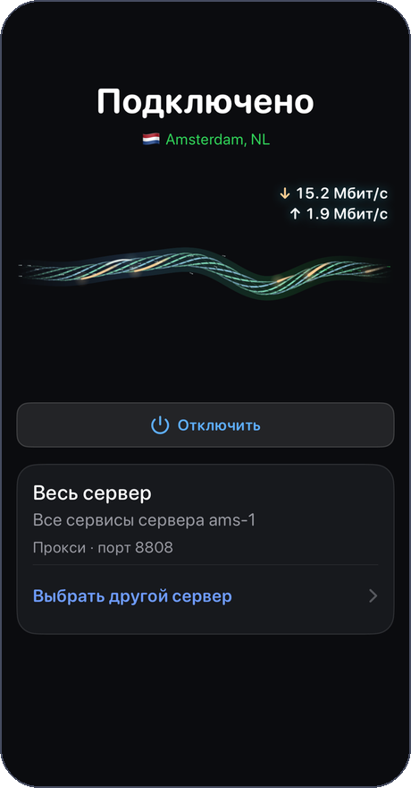
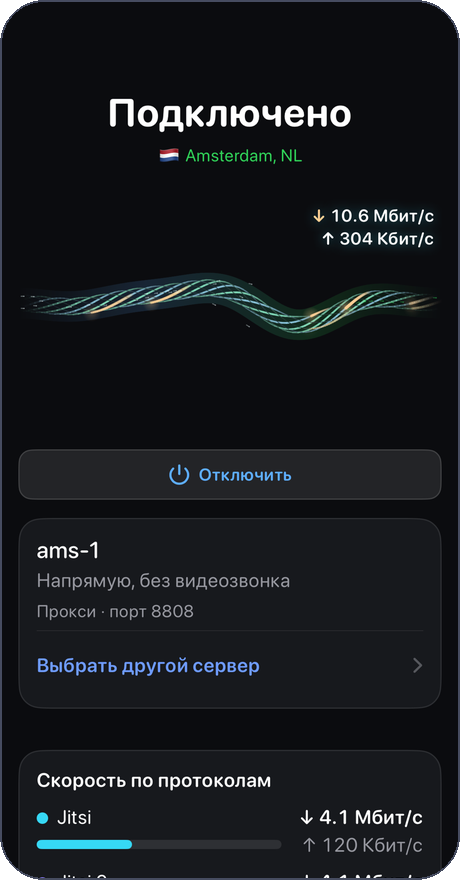
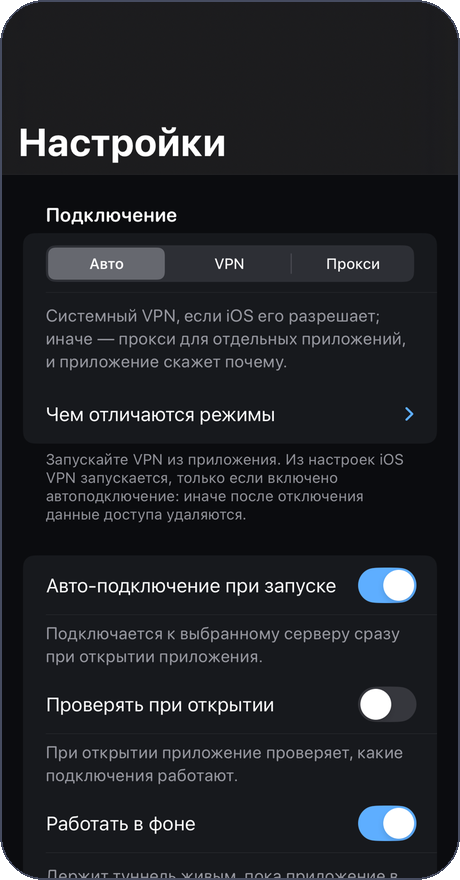
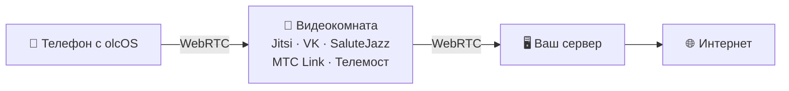

<div align="center">
  <a href="https://olcos.github.io"></a>
  <h1>olcOS</h1>
  <p><b>Ваш телефон. Ваш сервер. Ваше подключение.</b></p>
  <p>VPN и SOCKS5-прокси через собственный сервер, спрятанные внутри обычного видеозвонка.</p>
  <p>
    
    
    <a href="https://github.com/olcOS/olcos/releases/latest"></a>
    
  </p>
  <p>
    <a href="https://github.com/olcOS/olcos/releases/latest"></a>
    &nbsp;
    <a href="https://github.com/olcOS/olcos/releases/latest"></a>
  </p>
  <p><a href="https://olcos.github.io">Сайт</a> · <a href="https://github.com/olcOS/olcos-ios">iOS</a> · <a href="https://github.com/olcOS/olcos-android">Android</a> · <a href="README.en.md">English</a></p>
</div>

<p align="center">
  
  &nbsp;
  
  &nbsp;
  
</p>

## Как это работает



Сервис видеозвонков видит обычный звонок, а вы получаете VPN на весь телефон или SOCKS5-прокси для отдельных
приложений. Если звонок не нужен, есть прямой режим VLESS + REALITY.

## Возможности

| | |
|---|---|
| 🔗 **Весь сервер сразу** | Несколько комнат склеиваются в один канал. Большая загрузка идёт по всем, обрыв одной не рвёт соединение. |
| 🔁 **Не сдаётся** | Обрыв замечается быстро, переподключение идёт, пока вы его не остановите. Стоп только на неустранимых ошибках. |
| 📲 **Сервер с телефона** | Комнаты, ключи, обновление ядра и приглашения для близких — прямо из приложения. |
| 🛡 **VPN или прокси** | VPN на весь телефон или SOCKS5 для одного приложения, например Telegram. |
| 🔒 **Только ваше** | Никаких общих серверов и аккаунтов: трафик идёт через сервер, который принадлежит вам. |

## Поставить сервер

```bash
curl -fsSL https://raw.githubusercontent.com/olcOS/olcos/main/install.sh | sudo bash
```

Debian, Ubuntu, Fedora или CentOS с root-доступом. В конце скрипт покажет QR-код: отсканируйте его в olcOS, и телефон
станет владельцем сервера.

## Платформы

| | Требования | Исходный код |
|---|---|---|
| **iPhone и iPad** | iOS 17+, установка через Sideloadly, AltStore или SideStore | [olcos-ios](https://github.com/olcOS/olcos-ios) |
| **Android** | Android 8.0+, файл `.apk` | [olcos-android](https://github.com/olcOS/olcos-android) |
| **Сервер** | Linux с root-доступом, 1 ГБ памяти | [install.sh](install.sh) |

<details>
<summary><b>Как поставить приложение</b></summary>

**iPhone и iPad.** Скачайте `.ipa` из [последнего релиза](https://github.com/olcOS/olcos/releases/latest) и поставьте через
Sideloadly, AltStore или SideStore. С бесплатным Apple ID iOS не даёт приложениям делать VPN, поэтому работает режим SOCKS5.
VPN на весь телефон доступен при подписи платным аккаунтом разработчика.

**Android.** Скачайте `.apk`, разрешите установку из этого источника и откройте файл. Для VPN система один раз спросит
разрешение.
</details>

<details>
<summary><b>Скорость и честные ограничения</b></summary>

Скорость зависит от видеокомнаты, а не от вашего сервера. По замерам ядра на тестовом стенде: МТС Link около 15 Мбит/с,
Jitsi около 5, SaluteJazz 2–3. Для VK Звонков замеров пока нет. У вас цифры будут другими.

- Сервис видеозвонков может закрыть комнату, ввести лимит или отказать гостям. Поэтому olcOS держит несколько протоколов
  и умеет менять комнату.
- VPN пропускает TCP поверх IPv4. Приложениям, которым нужен UDP или IPv6, он может не подойти.
- Это бета: интерфейс и совместимость меняются.
- Используйте olcOS в рамках закона и правил сервисов, через которые идёт трафик.
</details>

<details>
<summary><b>Из чего это сделано</b></summary>

Клиенты: SwiftUI (iOS) и Kotlin с Jetpack Compose (Android). Общее ядро на Go: туннель поверх WebRTC на основе
[olcrtc](https://github.com/ghostlane-project/olcrtc) и склейка комнат в один канал. Лицензия MIT.
</details>
